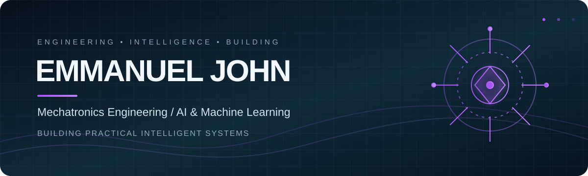

<!-- Profile README for @official-pam -->

  
   
  
  

## About

I'm a Mechatronics Engineering undergraduate at the **Federal University of Technology, Minna**, interested in building practical systems at the intersection of **AI, software, electronics, and intelligent machines**.

My current focus is machine learning and computer vision, alongside the engineering foundations required to take intelligent systems beyond the screen.

- Developing with Python and exploring machine learning, data science, and computer vision.
- Building experience with C++, MATLAB, and engineering tools.
- Exploring embedded systems, robotics, and control-oriented applications.
- Interested in applied AI for agriculture, safety, and real-world operational problems.

> Understand the problem. Build the system. Test it. Improve it.

## Technical toolkit

**Programming & development**

**Data science & machine learning**

**Mechatronics & embedded systems**

Tools shown reflect technologies I've used or am actively learning. The list is not a claim of expert-level proficiency in every tool.

## Selected projects

| Project | Focus |
|---|---|
| [Selective Smart Surveillance](https://github.com/official-pam/Selective-smart-surviellance-) | Computer vision for more selective and efficient surveillance workflows. |
| [Heart Disease Model](https://github.com/official-pam/heart_disease_model) | Machine learning and predictive modelling with health-related data. |
| [AjaTrade on N-Atlas](https://github.com/official-pam/Ajatrade-on-N-Atlas) | Software project exploring practical digital products. |
| [Taproot](https://github.com/official-pam/Taproot-) | An ongoing software project. See the repository for its current implementation. |

## What I'm working towards

- Stronger foundations in machine learning and model evaluation.
- Practical computer-vision systems that solve defined problems.
- Connecting AI with mechatronics and embedded engineering.
- Better software architecture, testing, and technical documentation.

   
  
  
  

